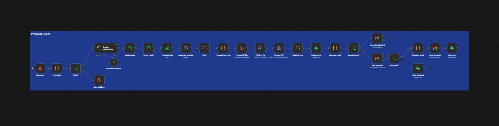
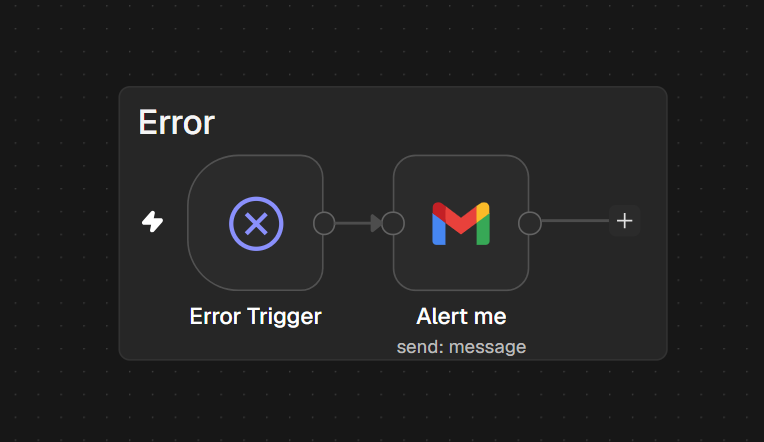

# Proposal Engine

An n8n workflow that turns a website intake form into a priced, branded PDF proposal — and sends it to the prospect only after a human approves it.

A prospect describes their project on a 3-step intake page. Within a minute, the owner receives an email with the generated proposal, the price breakdown, every warning worth checking, and two buttons: **send** or **don't send**. One click later, the prospect gets a personal email with their PDF attached. Every lead is logged in Supabase.



## How it works

| Stage | Nodes | What happens |
|---|---|---|
| **Intake** | Webhook → Normalize → Valid? | The intake page's server posts JSON with a secret header. Every field is checked against an allow-list; anything invalid stops the run and triggers an alert. |
| **Understand** | Extract requirements (Information Extractor + LLM) | The free-text answers become a fixed-schema object: project type, features, motion/3D, integrations, clarity, red flags, questions to ask. |
| **Identify** | Validity date → Format validity → Proposal hash → Assemble proposal | A deterministic proposal ID (SHA-256 of email + submission time) and a 15-day validity date. |
| **Price** | Price (Code) | A fixed pricing grid: base price per project type, add-ons, motion premium, rush fee, floor. The project value becomes a rental offer: setup fee + monthly fee, no commitment. Anything uncertain sets `needsReview`. |
| **Render** | Prepare Document → Proposal HTML → HTML to file → Render PDF | Client-facing wording, HTML-escaped input, a one-page A4 template, rendered to PDF by Gotenberg (headless Chromium). |
| **Log** | Build log row → Create a row | One row per proposal in Supabase, status `en_attente`, before the workflow pauses. |
| **Approve** | Approval email → Manual quote? → Ask approval → Approved? | The owner gets a decision-ready email and approves or declines. Manual quotes get an alert instead. |
| **Send** | Prospect email → Send proposal → Mark sent / Mark declined | The prospect receives a personal email with the PDF; the Supabase row records the decision. |

### Error handling

A separate workflow catches any failure in production runs and emails the failing node, the error and a link to the execution.



## Design decisions

- **The AI never sets a price.** The model only extracts and structures what the prospect wrote. Every number comes from a pricing grid in code, so every quote can be explained line by line.
- **Nothing reaches a prospect without a human click.** The approval step is where the "never overpromise" rule is enforced.
- **If the model shouldn't use a piece of information, it isn't sent to it.** The budget is withheld from the extraction prompt; budget-versus-price is a calculation done in code.
- **Deterministic IDs.** A retried run produces the same proposal ID, and a `unique` constraint in Supabase rejects the duplicate.
- **Test runs are safe.** Runs flagged `isTest` send the prospect email to the owner instead of the address in the form.
- **Untrusted input is escaped before rendering.** The PDF is rendered by a real browser, so prospect text never reaches it as HTML.

## Stack

n8n (self-hosted, Docker) · Ollama (LLM for extraction) · Gotenberg 8 (HTML → PDF) · Supabase (Postgres) · Gmail · a Next.js intake page posting to the webhook through a server route.

## Setup

### 1. Services

`setup/docker-compose.yml` runs n8n and Gotenberg side by side. Gotenberg has no published port: only n8n reaches it, at `http://gotenberg:3000`.

```powershell
docker compose up -d
```

Set `WEBHOOK_URL` and `N8N_EDITOR_BASE_URL` to the public address of your n8n instance.

### 2. Database

Run `setup/supabase-proposals.sql` in the Supabase SQL editor. It creates the `proposals` table with Row Level Security enabled and no policies: only the service role key (stored in n8n) can read or write it.

### 3. Import the workflows

In n8n, import both files from `workflows/`. Then:

1. Create and attach the credentials (none are included in this repo):
   - **Header Auth** on *Webhook* — name `X-CWB-Secret`, value: a long random secret
   - **Ollama** on *Ollama Chat Model*
   - **Supabase** on *Create a row*, *Mark sent*, *Mark declined*
   - **Gmail** on *Ask approval*, *Send proposal*, *Manual quote alert* and on *Alert me* in the error workflow
2. Replace the placeholders:
   - `YOUR_EMAIL@example.com` in *Ask approval*, *Manual quote alert*, *Prospect email* and *Alert me*
   - `VOTRE_EMAIL` / `VOTRE_TELEPHONE` in *Prepare Document* (printed in the PDF footer)
   - `YOUR_PHONE` in *Prospect email* (email signature)
3. In the main workflow's **Settings → Error Workflow**, select *Proposal Engine – Errors*.
4. Adjust the pricing grid at the top of the *Price* node.

### 4. Test

`setup/test-intake.ps1` sends a realistic fake prospect to the webhook. The secret is read from an environment variable, never from the file:

```powershell
$env:CWB_INTAKE_SECRET = "your-secret"
.\setup\test-intake.ps1
```

The script is saved as UTF-8 **with BOM** so Windows PowerShell 5.1 reads its accents and en dashes correctly.

## Data and privacy

The workflow processes prospects' personal data (name, email, company, project details). Publish a privacy notice next to the intake form and check the data-protection rules that apply where you operate.
